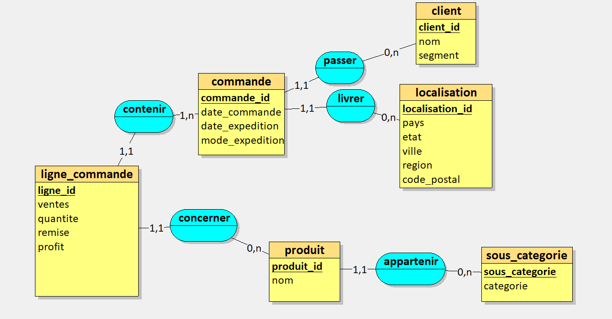
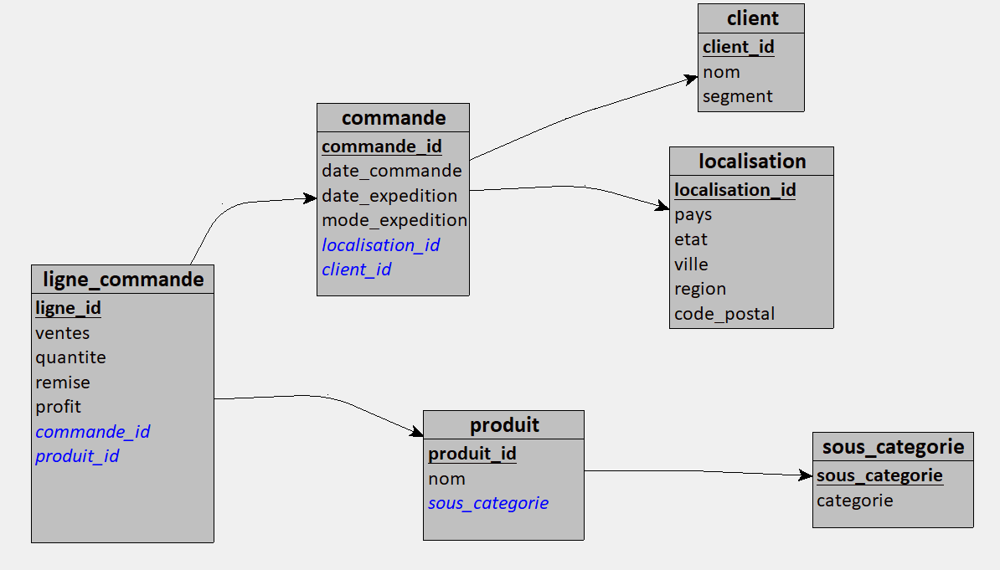
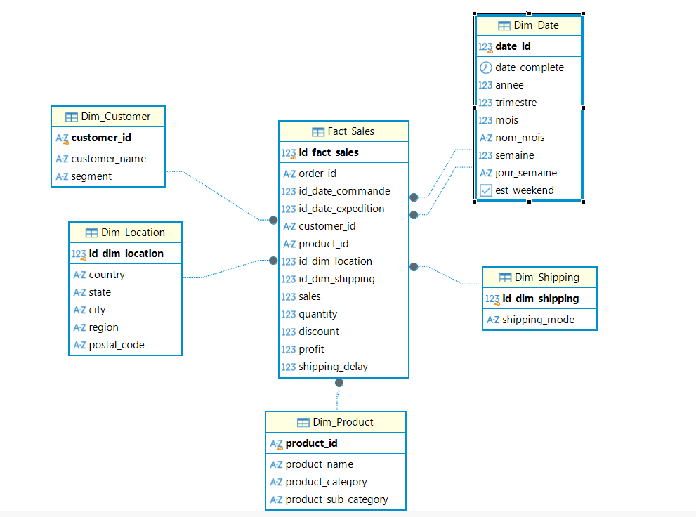

# Superstore Sales

Projet de fin de formation Développeur en IA chez Simplon Montpellier.

L'idée de départ : à partir des ventes d'une enseigne américaine de fournitures (le dataset [Superstore Sales](https://www.kaggle.com/datasets/ishanshrivastava28/superstore-sales) sur Kaggle), est-ce qu'on peut prévoir le chiffre d'affaires du mois prochain, par catégorie de produit et par région ?

Pour y répondre, j'ai monté toute la chaîne : récupération des données, deux bases DuckDB (une relationnelle, une en étoile), un modèle de prévision et un dashboard Streamlit. Le détail de la problématique, de mes hypothèses et des résultats est dans [docs/problematique.md](docs/problematique.md).

Dashboard en ligne : https://uqfm6vzd8qdvkdmg2z4vyn.streamlit.app/

## Lancer le projet

Il faut Python 3.12 ou plus récent.

```bash
git clone https://github.com/mmorkos-cyber/Superstore-Sales-Dataset-manipulation.git
cd Superstore-Sales-Dataset-manipulation
python -m pip install -r requirements.txt
python main.py
```

`main.py` fait tout dans l'ordre : il télécharge le CSV, construit les deux bases, entraîne le modèle, lance les tests entre chaque étape, puis ouvre le dashboard sur http://localhost:8501. Pas besoin de clé Kaggle, le dataset est public.

Si les bases existent déjà et que vous voulez juste le dashboard :

```bash
python -m streamlit run dashboard/app.py
```

J'utilise `python -m streamlit` plutôt que `streamlit` tout court parce que, sous Windows, la commande n'est pas toujours trouvée si le dossier des scripts Python n'est pas dans le PATH.

Les erreurs sont écrites dans le dossier `logs/`.

## Comment c'est organisé

```
├── api/                    API FastAPI qui sert les prévisions
├── dashboard/
│   ├── app.py              point d'entrée Streamlit, filtres et onglets
│   ├── db.py               connexion à la base analytique
│   └── onglets/            un fichier par onglet
├── data/
│   ├── raw/                CSV téléchargé (non versionné)
│   ├── db/                 bases DuckDB
│   └── modeles/            modèle entraîné + rapport d'entraînement
├── docs/                   problématique, dictionnaire des données, MCD, MLD, schéma en étoile
├── ETL_relationnelle/      CSV -> base relationnelle
├── ETL_analytique/         base relationnelle -> modèle en étoile
├── ML/                     exploration (matrice de corrélation) et entraînement
├── tests/                  tests pytest de chaque étape
├── utils/                  téléchargement du dataset et logger
├── main.py
├── Dockerfile
├── docker-compose.yml
└── requirements.txt
```

## Les données

Le CSV de départ, c'est une seule table de 21 colonnes où tout se répète : le nom du client, la catégorie du produit, l'adresse… sur chaque ligne de commande. Il y a aussi quelques pièges : le fichier n'est pas en UTF-8 (il faut le lire en `cp1252`), les dates sont du texte, et pandas lit les codes postaux comme des nombres, donc `01040` devient `1040`. Tout ça est corrigé dans l'ETL.

### Base relationnelle

Je l'ai modélisée avec Merise sur Looping, puis découpée en 6 tables : `client`, `localisation`, `commande`, `ligne_commande`, `produit` et `sous_categorie`. Au début j'avais aussi une table `categorie`, mais elle ne contenait qu'un nom, donc je l'ai retirée et la catégorie est devenue un attribut de la sous-catégorie.

Un point qui m'a fait changer le modèle : l'adresse est liée à la commande et pas au client, parce qu'un même client peut se faire livrer dans plusieurs villes.





### Base analytique

C'est celle que lisent le dashboard et le modèle. Une table de faits `Fact_Sales` (une ligne par ligne de commande : ventes, quantité, remise, profit, délai d'expédition) et cinq dimensions : date, client, produit, localisation et mode d'expédition.

La dimension date contient tous les jours de la période, même ceux sans vente, pour ne pas avoir de trous dans les séries temporelles. Elle est utilisée deux fois par la table de faits : une pour la date de commande, une pour la date d'expédition.



Toutes les colonnes sont décrites dans le [dictionnaire des données](docs/Dictionnaire_des_données.md).

## Le modèle

Je prévois le chiffre d'affaires mensuel pour chaque couple catégorie × région, à partir de l'année, du mois, de la catégorie et de la région. J'ai volontairement laissé de côté le profit et la quantité : on ne les connaît qu'une fois la vente faite, donc ils n'ont rien à faire dans une prévision.

Les données sont découpées dans le temps : le modèle apprend sur les trois premières années et il est testé sur la dernière. J'ai comparé une régression linéaire et un Random Forest :

| Modèle | MAE | MAPE |
|---|---|---|
| Régression linéaire | 2 372 $ | 118 % |
| Random Forest | 2 610 $ | 251 % |

La régression linéaire est gardée, mais honnêtement les résultats restent faibles : le modèle donne un ordre de grandeur, pas une prévision fiable. L'explication complète est dans [docs/problematique.md](docs/problematique.md).

Le modèle est enregistré dans `data/modeles/prediction_ventes.joblib`, avec les scores de chaque entraînement dans `rapport_entrainement.json`.

## Le dashboard

Huit onglets : vue d'ensemble (KPI), clients, commercial, géographie (carte des ventes par état), logistique, rentabilité, évolution dans le temps, et prévision. Dans le panneau de gauche, on peut filtrer par année et par région ; les filtres s'appliquent partout sauf à l'onglet prévision, qui a ses propres choix de catégorie et de région.

Ce que j'en retire :

- Les ventes suivent le même cycle chaque année : creux en janvier-février, pics en septembre, novembre et décembre, et une baisse en octobre à chaque fois.
- 2011 et 2012 se ressemblent, puis le chiffre d'affaires monte en 2013 et surtout en 2014.
- Les remises coûtent cher : jusqu'à 20 % ça reste rentable, mais à partir de 30 % chaque niveau de remise fait perdre de l'argent.
- Le segment Consumer représente un peu plus de la moitié des clients (51,6 %) et du chiffre d'affaires (environ 1,16 M$), et c'est aussi lui qui rapporte le plus de profit. Corporate arrive deuxième (environ 30 % des clients), Home Office troisième (environ 19 %).
- Phones et Chairs dominent les ventes avec plus de 300 000 $ chacune. Mais vendre beaucoup ne veut pas dire gagner beaucoup : Tables est la 4e sous-catégorie en chiffre d'affaires et pourtant la plus déficitaire (environ −18 000 $), suivie de Bookcases et Supplies. À l'inverse, Copiers n'est que 8e en ventes mais c'est la plus rentable, avec environ 55 000 $ de profit.
- Les ventes sont très concentrées : la Californie arrive largement en tête, devant l'État de New York, puis le Texas et l'État de Washington. Une grande partie des états du centre du pays pèse très peu.
- Standard Class représente environ 60 % des commandes (2 994 sur 5 009), pour un délai moyen de 5 jours. First Class et Second Class tournent autour de 2 et 3 jours, et Same Day part le jour même, mais ne concerne que 264 commandes.

## Tests

```bash
python -m pytest -v
```

Les tests vérifient les données après chaque étape : clés primaires uniques, clés étrangères valides, aucune ligne perdue, codes postaux sur 5 caractères, calendrier sans jour manquant, délais d'expédition positifs, et un modèle qui renvoie bien 12 prévisions. `main.py` les lance aussi entre les étapes et s'arrête si l'un d'eux échoue.

## API et Docker

L'API expose le modèle sur deux routes : `/health` pour vérifier qu'elle tourne, et `/prevision` qui renvoie les 12 mois prévus pour une catégorie, une région et une année.

```bash
python -m uvicorn api.main:app --reload
```

La doc interactive est sur http://localhost:8000/docs. Exemple de requête :

```json
{ "categorie": "Furniture", "region": "West", "annee": 2015 }
```

Pour tout lancer avec Docker (dashboard sur le port 8501, API sur le 8000) :

```bash
docker compose up -d --build
```

L'image utilise la base analytique et le modèle présents dans `data/`, donc il faut avoir lancé `main.py` au moins une fois avant.

## Stack

Python, pandas, DuckDB, scikit-learn, Streamlit, Plotly, FastAPI, Docker, pytest. MCD et MLD faits avec Looping.

## Défis et badges

Défis : Star Schema, Merise, Streamlit, DuckDB, Random Forest, régression linéaire, comparaison de modèles, matrice de corrélation, Docker, déploiement, tests.

Badges visés : Data Engineer, Data Architect, Data Analyst, IA, Développeur Data, Qualité & Industrialisation, Cloud & Déploiement.